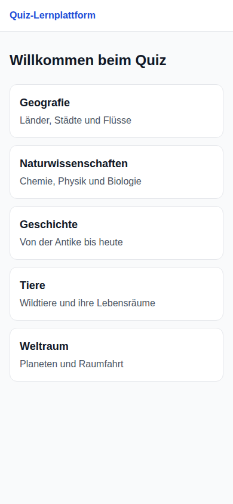
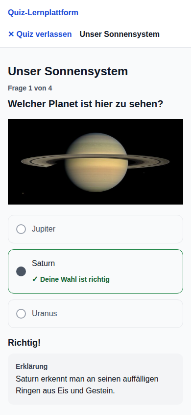
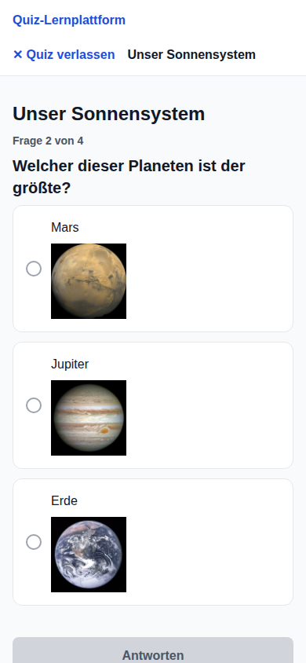
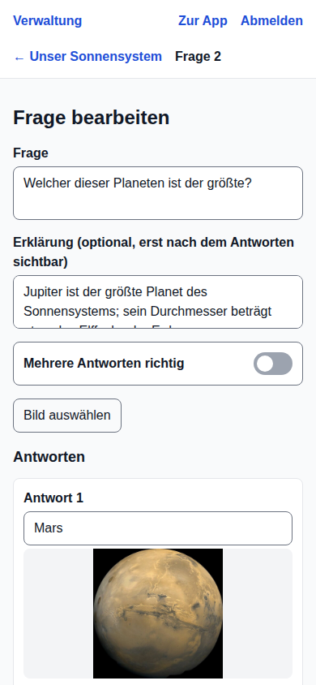
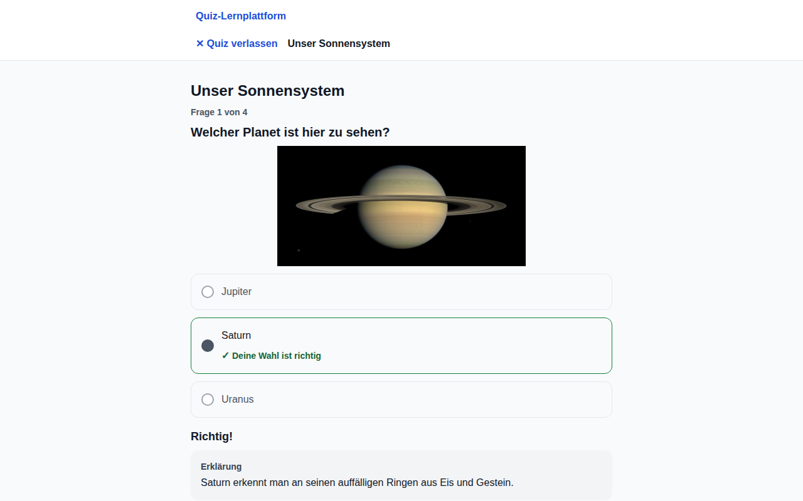
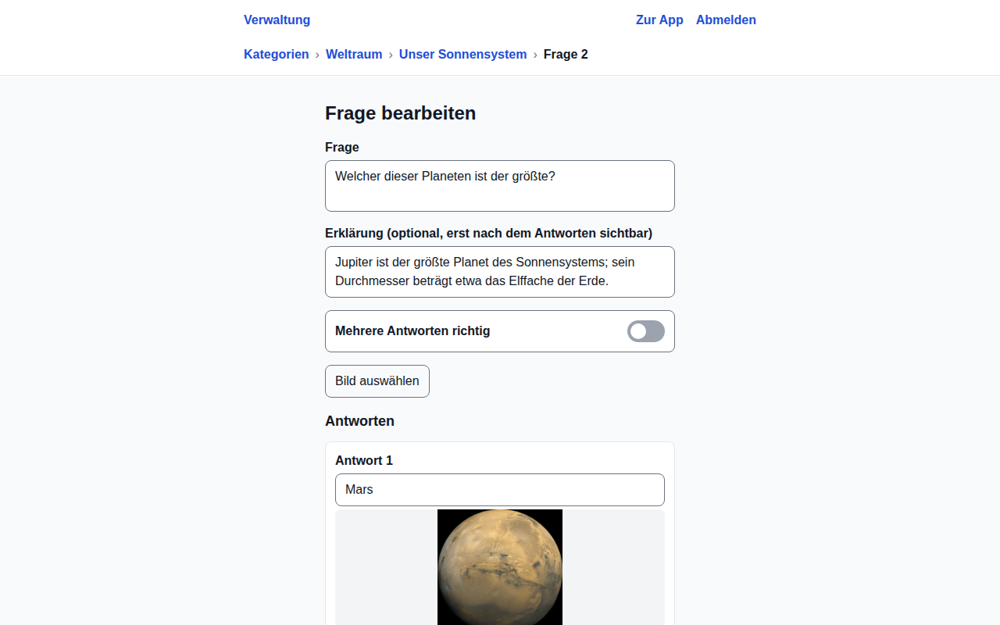
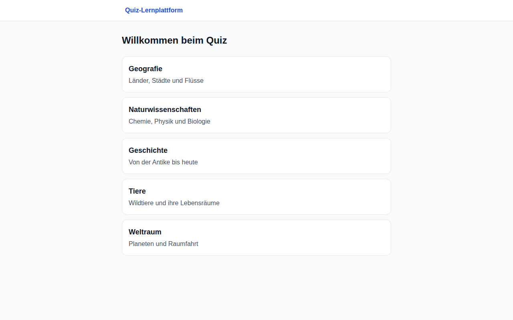
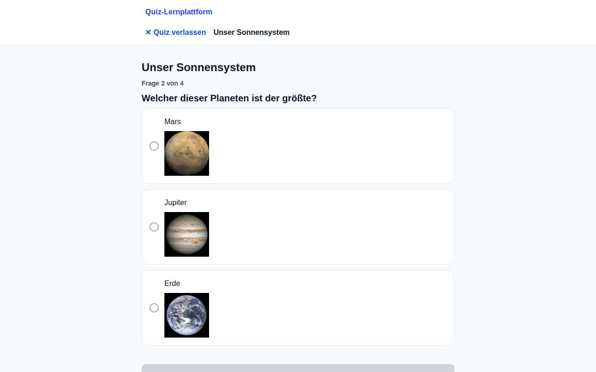

# Quiz learning platform

A personal sandbox project in which I test what current AI engineering can do
and learn agentic development workflows hands-on.

It is built with a test-gated, multi-agent Claude Code workflow: hook-enforced
quality gates, role-restricted subagents, and an orchestrator that runs issues
in parallel in isolated git worktrees, each with its own database stack. The
harness is tested, and the ADRs record what it measured.

Since the point is to see how far the agents get on their own, the AI-written
code here is not read line by line; it rests on the automated gates, the tests
and agent reviews.

The project itself is a free, non-commercial learning platform:
multiple-choice quizzes in categories, played anonymously or with an account,
and managed by admins in the same app. It runs on the web, Android and iOS
(Expo) with Supabase as the backend, and is built test-first with Claude Code
as the main implementer.

**Live demo:** [small-quiz-poc.pages.dev](https://small-quiz-poc.pages.dev/)
(German UI; its quizzes are whatever the admins there entered, while the
screenshots below show the local seed data).

## Screenshots

  
  
  
  

Desktop

| Learner                                                                                                                   | Admin                                                                                               |
| ------------------------------------------------------------------------------------------------------------------------- | --------------------------------------------------------------------------------------------------- |
|  |  |
|                                        |         |

The screenshots are taken by `npm run screenshots:readme`
([`e2e/readme.shots.ts`](e2e/readme.shots.ts)); a pull request that changes
one of these screens retakes them.

## How an issue goes through the workflow

1. **One issue, one slice, one worktree.** `npm run slice` picks the next
   issue, creates its worktree and gives it its own local Supabase stack
   ([`scripts/slice.mjs`](scripts/slice.mjs),
   [`scripts/stack.mjs`](scripts/stack.mjs)).
2. **Failing tests first.** The
   [`test-writer`](.claude/agents/test-writer.md) subagent turns the
   acceptance criteria into failing tests; a hook stops it from writing
   anything but test files
   ([`test-writer-scope.mjs`](.claude/hooks/test-writer-scope.mjs)).
3. **Gate 1.** The failing tests are reviewed and become the spec. Changes
   to database security (RLS policies, grants, `security definer` functions)
   always wait for a human here.
4. **Green under hooks.** After every edit,
   [`post-edit.mjs`](.claude/hooks/post-edit.mjs) runs ESLint and the
   typecheck, and for migrations rebuilds the database and runs the pgTAP
   tests. [`stop-gate.mjs`](.claude/hooks/stop-gate.mjs) won't let the agent
   finish while related tests or the typecheck are red, and escalates after
   10 blocked attempts.
5. **Verify and review.** The
   [`ui-verifier`](.claude/agents/ui-verifier.md) checks the running app at
   phone and desktop width through Playwright; the read-only
   [`reviewer`](.claude/agents/reviewer.md) reviews the diff for correctness,
   security and the project rules.
6. **PR and CI.** Lint, typecheck, Jest with an 80 % coverage threshold,
   pgTAP, Playwright with axe accessibility checks; on `main`, CI migrates
   the hosted database and deploys to Cloudflare Pages.

The [`orchestrator`](.claude/skills/orchestrator/SKILL.md) runs several
slices at once as [workflows](.claude/workflows/slice.js), within the
machine's resources ([`scripts/capacity.mjs`](scripts/capacity.mjs)). The
hooks themselves are tested in [`tests/hooks/`](tests/hooks/), and
[ADR 0003](docs/adr/0003-agentic-test-first-workflow.md) records how the
workflow was measured and changed: for example, the 12 slices of phase 1
took about 18 hours of wall clock against a planned three weeks, for about
$110.

## Stack

Expo (React Native, TypeScript, Expo Router), NativeWind, i18next ·
Supabase (Postgres with row-level security, Auth with TOTP for admins,
Storage) · Jest, React Native Testing Library, pgTAP, Playwright, axe,
Stryker · GitHub Actions, Cloudflare Pages, EAS for Android builds.

Start with [`CLAUDE.md`](CLAUDE.md) for the commands, layout and rules, and
[`docs/plan/`](docs/plan/) for the scope, architecture and implementation plan.

Licensed under the [GNU AGPL v3](LICENSE).
